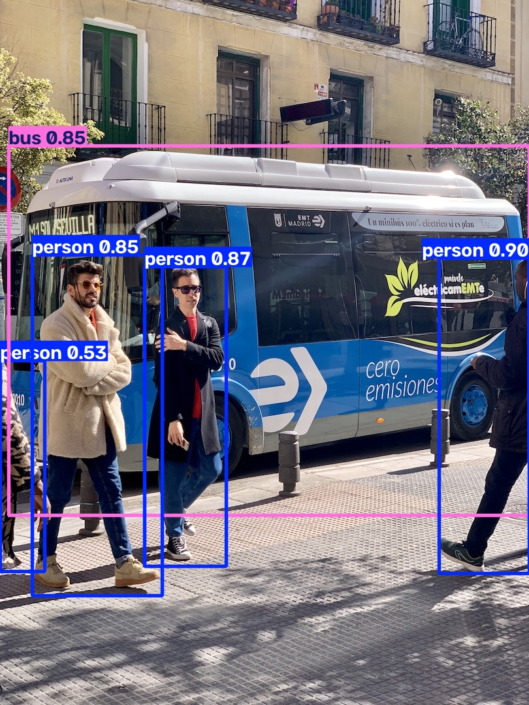
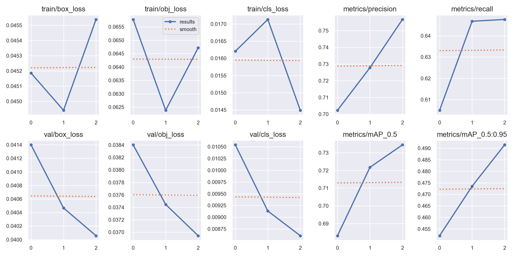

# AI-Midterm-YOLOv5
# AI期中報告：YOLOv5影像辨識與模型訓練

## 一、專題介紹

本專題以 YOLOv5 深度學習模型為主，透過 Google Colab 雲端運算平台，實作人工智慧影像辨識及模型訓練。

藉由本次專題，學習如何建立 AI 執行環境、取得模型、執行影像辨識，以及觀察模型訓練結果。

## 二、研究動機

隨著人工智慧技術的發展，影像辨識已廣泛應用於智慧監控、自動駕駛及物件偵測等領域。

因此，本專題希望透過實際操作 YOLOv5 模型，了解人工智慧如何辨識圖片中的物件，並學習深度學習模型的基本操作流程。

## 三、研究目的

1.了解 YOLOv5 影像辨識模型的基本原理。

2.學習使用 Google Colab 執行 AI 程式。

3.熟悉 GPU 加速器的設定及使用。

4.執行 AI 模型並進行影像辨識。

5.觀察模型訓練結果及辨識效果。

6.將實作過程整理成完整的 AI 專題報告。

## 四、使用工具

**工具**         /          **用途**
______________________________________________________
Google Colab     /   執行 Python 程式及 AI 模型
______________________________________________________
Python           /   程式語言
______________________________________________________
YOLOv5           /   影像辨識及物件偵測
______________________________________________________
PyTorch          /   深度學習框架
______________________________________________________
GitHub           /   儲存及展示專題程式
______________________________________________________
Google Drive     /   儲存相關檔案及成果

## 五、研究方法

本專題使用 Google Colab 作為 AI 模型執行環境，透過 YOLOv5 進行影像辨識及模型訓練。

研究流程如下：

1.建立 Google Colab 執行環境。

2.設定 GPU 硬體加速器。

3.取得 YOLOv5 專案程式。

4.安裝執行所需套件。

5.使用預訓練模型進行影像辨識。

6.執行模型訓練。

7.觀察訓練曲線及辨識結果。

8.整理實驗成果並上傳至 GitHub。

## 六、實作步驟

**6.1 建立 Google Colab 環境**

使用 Google Colab 建立 Python Notebook，並設定 GPU 加速器，以提供深度學習模型所需的運算資源。

**6.2 取得 YOLOv5 專案**

透過 GitHub 取得 YOLOv5 專案程式，並安裝所需的 Python 套件。

**6.3 執行影像辨識**

使用 YOLOv5 預訓練模型輸入測試圖片，讓模型辨識影像中的物件，並產生物件位置框及類別標籤。

**6.4 執行模型訓練**

使用專案設定的資料集進行模型訓練，觀察模型在訓練過程中的變化及相關評估指標。

**6.5 查看訓練成果**

透過訓練結果圖及模型輸出，了解模型的訓練情況，並使用訓練完成的權重進行影像辨識。

## 七、實驗成果

本專題已使用 Google Colab 執行 YOLOv5 影像辨識及模型訓練程式。

實驗成果包含：

• AI 影像辨識結果

• 模型訓練過程

• 模型訓練後的辨識成果(曲線圖)

## 八、心得與結論

透過本次 AI 期中專題，學習到如何使用 Google Colab 執行深度學習程式，並實際操作 YOLOv5 影像辨識模型。
在實作過程中，了解 AI 模型需要透過資料及訓練流程進行學習，也認識到 GPU 加速器對於深度學習運算的重要性。
本次專題讓我對人工智慧影像辨識技術有更深入的認識，並學習如何透過 GitHub 管理及展示自己的專題成果。
未來可以進一步使用自行蒐集的圖片進行模型訓練，並將影像辨識技術應用於更多實際情境。

## 九、專題檔案

• AI期中報告_YOLOv5影像辨識.ipynb：本專題的程式碼及執行流程。

• README.md：專題介紹、研究方法及成果說明。

## 十、參考資料

• CSDN 教學文章：Colab跑項目

• YOLOv5 官方 GitHub：https://github.com/ultralytics/yolov5

• Google Colab：https://colab.research.google.com/
